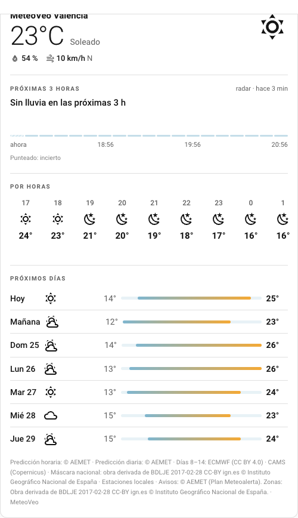
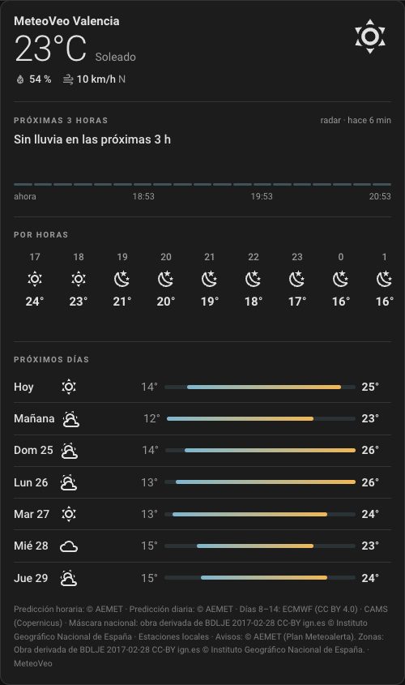
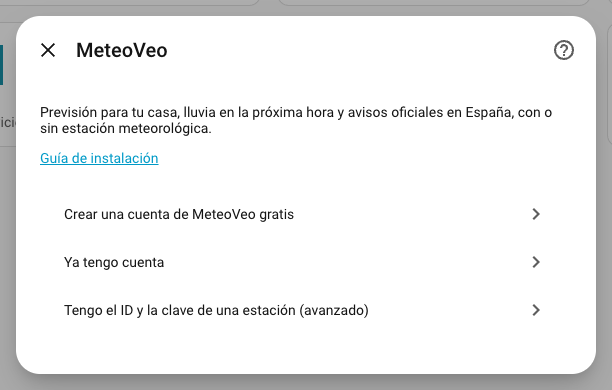
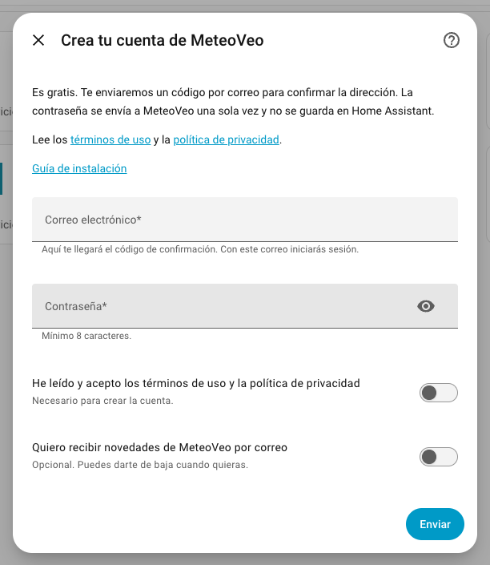
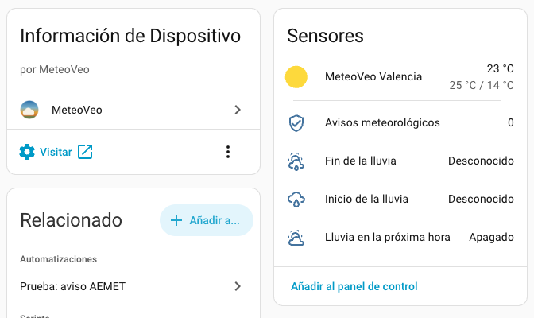

# MeteoVeo — Home Assistant integration

[MeteoVeo](https://www.meteoveo.com) forecasts for your home in Spain — the
hourly and daily forecast, **rain in the next hour** from radar nowcasting,
and the official weather warnings — in Home Assistant. **No weather station
needed.** If you do have one, the integration can also share its readings
with MeteoVeo and bring station-specific extras back.

<p align="center">
  
  &nbsp;
  
</p>

> **Status: early development.** Submitted to the HACS default list.

The integration ships its own brand icons in `custom_components/meteoveo/brand/`.
Since Home Assistant 2026.3.0 that is the supported route for custom
integrations — the `home-assistant/brands` repository no longer accepts them.

## Documentation

- [Setup guide](docs/setup.md) — creating an account or signing in, the place, an optional station
- [Measurements](docs/measurements.md) — what each station field expects, units, pitfalls
- [Reciprocity](docs/reciprocity.md) — what a station that stops reporting loses (and what it never loses)
- [Troubleshooting](docs/troubleshooting.md) — errors and what they mean

## Installation

### HACS (recommended)

1. Open **HACS** and search for **MeteoVeo**, or use this button:

   [](https://my.home-assistant.io/redirect/hacs_repository/?owner=Meteoveo&repository=ha-meteoveo&category=integration)

2. **Download**, then restart Home Assistant.
3. Add the integration:

   [](https://my.home-assistant.io/redirect/config_flow_start/?domain=meteoveo)

If MeteoVeo does not show up in the HACS search yet, add it as a custom
repository: HACS → ⋮ → **Custom repositories** → add
`https://github.com/meteoveo/ha-meteoveo`, category **Integration**.

### Manually

1. Copy `custom_components/meteoveo` into your Home Assistant
   `config/custom_components/` directory
2. Restart Home Assistant

## Setup

**Settings → Devices & Services → Add Integration → MeteoVeo**, then pick one:

| Option | For whom | What you enter |
|---|---|---|
| **Create a free MeteoVeo account** | Everyone new to MeteoVeo | Email, password (at least 8 characters), accept the terms; then the code we email you |
| **I already have an account** | MeteoVeo app or web users | Email and password |
| **I have a station ID and key (advanced)** | Stations already set up on meteoveo.com | Station ID and key — the 0.1.x setup, unchanged |

<p align="center">
  
  &nbsp;
  
</p>

The first two continue with:

1. **The place** — your Home Assistant home is preselected; drag the pin to
   change it. MeteoVeo covers Spain, including the Balearic and Canary
   Islands, Ceuta and Melilla. The place is stored rounded to about 1 km.
2. **"Do you have a weather station in Home Assistant?"** — answer no and
   you are done. Answer yes to give it a name and sensor height and to map
   its entities (every field optional); readings are then uploaded once a
   minute.

Everything is checked while you are still on the screen. Signing up needs no
browser. The terms of use are at
[meteoveo.com/legal/terminos](https://www.meteoveo.com/legal/terminos), the
privacy policy at
[meteoveo.com/legal/privacidad](https://www.meteoveo.com/legal/privacidad);
marketing email is a separate box, off unless you tick it.

**Created your account with Google, Apple or a passkey?** It has no password
yet. Set one in the MeteoVeo app (**Account → Password**), then sign in here.

### What is stored

Your password and your account session are **not** stored. After setup Home
Assistant keeps a restricted **integration key** that can read the forecast
for that one place — it cannot sign in, change the account or make
purchases. It is stored with your email address (to prefill the sign-in if
the key is ever revoked) and the rounded place. With a station, the station's
upload key is stored as well.

## What you get

**For everyone** — one device, named “MeteoVeo <town>” (you can rename it):

<p align="center">
  
</p>

| Entity | Meaning |
|---|---|
| `weather.meteoveo_<town>` | Current conditions, hourly forecast (48 h) and daily forecast (7 days). Attribution to the data sources is in the entity's attributes. |
| `binary_sensor.meteoveo_<town>_rain_in_the_next_hour` | On when rain is expected within 60 minutes. Attributes: `rain_now`, `starts_at`, `ends_at`, `issued_at`, `age_minutes`, and `steps` — ten-minute steps with `band` (`none`, `light`, `moderate`, `heavy`), `source` (`radar` or `model`) and `uncertain`. Unavailable outside nowcast coverage. |
| `sensor.meteoveo_<town>_rain_start` / `_rain_end` | When the next rain starts / when the current rain stops (timestamps). |
| `sensor.meteoveo_<town>_weather_warnings` | Number of active official warnings; `highest_level` (`none`, `yellow`, `orange`, `red`) and the `warnings` list as attributes. |
| `binary_sensor.meteoveo_<town>_yellow_warning` / `_orange_warning` / `_red_warning` | On while an official warning of that level is in force (started, not expired). |
| `sensor.meteoveo_<town>_next_warning` | When the next warning that has not started yet begins. |
| `event.meteoveo_<town>_new_warning` | Fires once for every new warning; the event type is the level, the headline and validity are attributes. Warnings already known at start-up do not fire again. |
| `sensor.meteoveo_<town>_minutes_until_rain` | Minutes until it rains — `0` while raining, unknown when none is expected. A number, so a *numeric state* trigger works without templates. |
| `sensor.meteoveo_<town>_rain_intensity_now` | `none`, `light`, `moderate` or `heavy`, from the nowcast step covering now. |
| `sensor.meteoveo_<town>_feels_like` / `_dew_point` | Apparent temperature of the current hour; dew point from the current temperature and humidity. |
| `sensor.meteoveo_<town>_uv_index` / `_uv_index_today_max` | UV index of the current hour, and today's maximum. |

A MeteoVeo Plus account sees its Plus level in Home Assistant as well, as
soon as it is active.

**With a station**, additionally:

- **Best forecast model** for your station, with its error and bias. Until
  there is enough history it says `collecting` and counts down the days; if
  the station stays silent for 12 hours it says `paused`.
- **Sensor problem** — on when the service flags something about your
  station, with the individual findings as an attribute.
- **Accepted uploads** and **Last upload**, so a silent failure is visible.
- **Station extras remaining** — see below.

Station readings you choose to upload:

| Measurement | Units accepted |
|---|---|
| Temperature | °C, °F |
| Humidity | % |
| Pressure (station level, not sea level) | hPa, mbar, inHg |
| Wind speed | m/s, km/h, mph |
| Wind gust | m/s, km/h, mph |
| Wind direction | degrees |
| Daily rainfall (accumulated since midnight) | mm, in |
| Solar radiation | W/m² |

Conversion is automatic. A reading that is `unknown`, `unavailable` or
physically impossible is **left out** rather than sent as zero.

### The card

The integration includes a dashboard card — no separate download, no
resource to add. Edit a dashboard → **Add card** → search **MeteoVeo**. It
shows the conditions now, the next hour's rain, the hourly strip and the
daily list, in your theme's light or dark colours. Options and YAML:
[docs/card.md](docs/card.md).

### Blueprints

Five ready-made automations, imported with one click:

| Blueprint | What it does | Import |
|---|---|---|
| **Rain in the next minutes** | Runs your actions when rain is expected within the minutes you choose (10–120, default 30) — close the awning, shut the skylight, bring in the laundry, pause the irrigation. Fires once per rain spell. | [](https://my.home-assistant.io/redirect/blueprint_import/?blueprint_url=https%3A%2F%2Fgithub.com%2FMeteoveo%2Fha-meteoveo%2Fblob%2Fmain%2Fblueprints%2Fautomation%2Fmeteoveo%2Frain_soon.yaml) |
| **Rain has stopped** | Runs your actions once the rain is over and the sensor has stayed dry for the minutes you choose — reopen the awning, resume the irrigation. | [](https://my.home-assistant.io/redirect/blueprint_import/?blueprint_url=https%3A%2F%2Fgithub.com%2FMeteoveo%2Fha-meteoveo%2Fblob%2Fmain%2Fblueprints%2Fautomation%2Fmeteoveo%2Frain_stopped.yaml) |
| **Frost tomorrow** | Every evening checks tomorrow's minimum in the forecast and runs your actions at or below your threshold (default 2 °C); the minimum is available as `{{ low }}`. | [](https://my.home-assistant.io/redirect/blueprint_import/?blueprint_url=https%3A%2F%2Fgithub.com%2FMeteoveo%2Fha-meteoveo%2Fblob%2Fmain%2Fblueprints%2Fautomation%2Fmeteoveo%2Ffrost_tomorrow.yaml) |
| **Voice assistant answers** | Ask Assist — with Home Assistant's own local assistant — *"¿Va a llover hoy?"*, *"¿Cuándo va a llover?"*, *"¿Hay avisos?"*, *"¿Qué tiempo hará mañana?"* (also in English and Catalan) and get the answer from MeteoVeo: rain now or coming and until when, the next rainy day, warnings with their validity, tomorrow's forecast. Pick only your MeteoVeo weather entity. | [](https://my.home-assistant.io/redirect/blueprint_import/?blueprint_url=https%3A%2F%2Fgithub.com%2FMeteoveo%2Fha-meteoveo%2Fblob%2Fmain%2Fblueprints%2Fautomation%2Fmeteoveo%2Fvoice_assistant.yaml) |
| **AEMET weather warning** | Runs your actions when an official warning reaches yellow, orange or red at your place; the warning text is available as `{{ headline }}`. | [](https://my.home-assistant.io/redirect/blueprint_import/?blueprint_url=https%3A%2F%2Fgithub.com%2FMeteoveo%2Fha-meteoveo%2Fblob%2Fmain%2Fblueprints%2Fautomation%2Fmeteoveo%2Faemet_warning.yaml) |

## Why a station owner would use this

Most consumer weather-station gateways — the Fine Offset family, sold as
Ecowitt, Ambient Weather, Froggit, Sainlogic, GARNI and others — have exactly
**one** "customized upload" slot. If Home Assistant already occupies it, there
is no room for a second service. This integration removes the conflict: the
device keeps talking to Home Assistant, and Home Assistant forwards to
MeteoVeo. It also covers hardware that cannot upload to a custom server at
all (Davis, Netatmo, La Crosse, AcuRite).

## A station that stops reporting

The forecast is **always** available, station or not. What a station that
goes silent for **12 hours** pauses are the extras computed from its own
readings — today the best-model verdict. The first readings that arrive
restore them immediately. You are emailed after 1, 6 and 12 hours of
silence, and **Station extras remaining** counts down the margin so an
automation can warn you first:

```yaml
automation:
  - alias: Warn before the MeteoVeo station extras pause
    trigger:
      - platform: numeric_state
        entity_id: sensor.<your_station>_station_extras_remaining
        below: 3
    action:
      - action: notify.persistent_notification
        data:
          message: "The station has not reported for a while."
```

## Requirements

- Home Assistant 2024.12 or newer
- A place in Spain (mainland, Balearic or Canary Islands, Ceuta, Melilla)
- A weather station is **optional**

## Options

**Settings → Devices & Services → MeteoVeo → Configure**:

- **Change the place** — the forecast moves; entity IDs stay.
- **Station measurements** — which entity feeds which measurement (station
  entries). Clearing every measurement is allowed; uploads simply stop.
- **Delete my MeteoVeo account** — see below.

## If MeteoVeo asks you to sign in again

Home Assistant shows a repair notification when the integration key is no
longer accepted (for example after you removed the connection elsewhere).
Sign in with the same account; the place, the station and the entity IDs are
kept. Station-key entries ask for the new station key instead.

## Removal

**Settings → Devices & Services → MeteoVeo → ⋮ → Delete.** This removes the
entities, stops uploads and revokes the integration key. Your MeteoVeo
account, any station and its readings stay.

If you installed manually, also delete `config/custom_components/meteoveo`.

## Deleting your MeteoVeo account

**Configure → Delete my MeteoVeo account.** Type your email, your password,
and your email once more to confirm. This **cannot be undone**: the account,
profile, photos, and your stations' names and keys are deleted, and every
Home Assistant connection to the account stops (the integration removes
itself and leaves a notification). Readings already sent stay, anonymously.
**An App Store or Google Play subscription is not cancelled by this** —
cancel it in the store. An account without a password is deleted in the
MeteoVeo app instead.

## Troubleshooting

| Symptom | Cause |
|---|---|
| *"Email or password not accepted"* | Wrong password — or the account was created with Google, Apple or a passkey and has no password yet. |
| *"MeteoVeo has no forecast there"* | The pin is outside Spain, the Balearic or Canary Islands, Ceuta or Melilla. |
| *"The station ID or key was not accepted"* | Wrong credentials, or a new key was generated and invalidated this one. |
| *"Could not reach MeteoVeo"* | The service could not be contacted. Nothing needs changing; try again shortly. |
| Rain entities are unavailable | The place is outside radar nowcast coverage. The forecast still works. |
| Uploads accepted stays at 0 | No measurement is mapped, or every mapped entity is unavailable. |

Debug logging:

```yaml
logger:
  logs:
    custom_components.meteoveo: debug
```

Passwords, keys and tokens are excluded from log output, and diagnostics
downloads redact them along with your email and coordinates.

## Privacy and security

See [SECURITY.md](SECURITY.md). In short: all requests use TLS; the password
is never stored; the stored integration key reads the forecast for one place
and nothing else; a station credential is limited to that one station.

## Development

```bash
python3.13 -m venv .venv
.venv/bin/pip install -r requirements-test.txt
.venv/bin/python scripts/audit.py   # pre-publication check
.venv/bin/python -m pytest -q
```

## License

MIT
